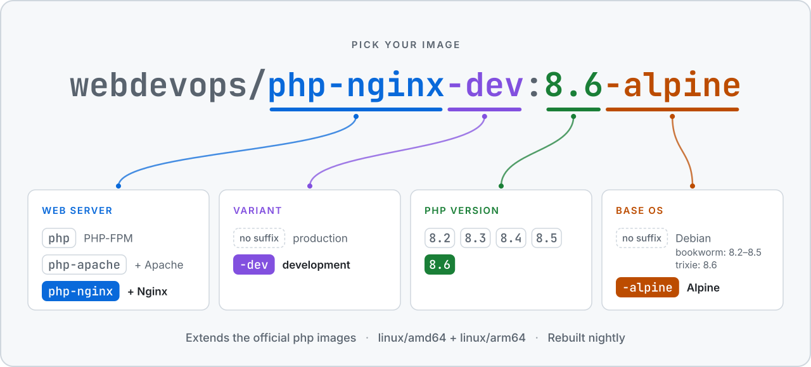

<picture>
  <source media="(prefers-color-scheme: dark)" srcset="docs/assets/readme-banner-dark.svg">
  
</picture>

# PHP docker images with super powers 🚀

We provide images which extend the official [PHP-Images](https://hub.docker.com/_/php/tags).
We add additional stuff like:

* almost any PHP module preinstalled
* configuration based on ENV variables
* run multiple services (like php-fpm and nginx) with supervisord

[](https://github.com/webdevops/Dockerfile/issues)[](https://github.com/webdevops/Dockerfile/network)[](https://github.com/webdevops/Dockerfile/stargazers)[](https://github.com/webdevops/Dockerfile/blob/master/LICENSE)
[](https://github.com/webdevops/Dockerfile/actions/workflows/build.yaml)

## Quick start

Save this as `compose.yaml` in your project (with the entry point in `public/index.php`) and run `docker compose up -d`:

```yaml
services:
  app:
    image: webdevops/php-nginx:8.5
    ports:
      - "8080:80"
    volumes:
      - ./:/app
    environment:
      WEB_DOCUMENT_ROOT: /app/public
```

The application is then available at http://localhost:8080. All images, settings and hooks are described in the [documentation](docs/README.md).

The images run on `linux/amd64` and `linux/arm64` and are rebuilt every night, so a tag such as `8.5` gets new images daily. To pin an image, see [Platforms and updates](docs/README.md#platforms-and-updates).

## Communication and support

Found a bug or have a question? Write an issue in our [GitHub repository](https://github.com/webdevops/Dockerfile/issues). Problems we already know about are listed in [Known issues](docs/known-issues.md).

Or join our discord https://discord.gg/BpBZtXAgJz

## Build process

### File generation

The general build process is currently a mixture of python jinja2 legacy and PHP.

First we build the files inside the `docker` directory using this command:

```
docker run --rm -ti -v $PWD:/app -w /app webdevops/dockerfile-build-env make provision
``` 

It will use the Jinja2 templates inside of the `template` directory and the 
config files from the `provisioning` directory.

**The generated files in the `docker` directory (`Dockerfile` and `conf/`) are never modified manually.**
Edit the `Dockerfile.jinja2` templates next to them, the shared templates in `template` or the files in `provisioning` instead.
`make provision` copies the `provisioning` files into the `conf/` directories as configured in `conf/provision.yml`.

*This will be replaced with PHP twig templates in the future to streamline everything.*

### Building in CI

We generate the GitHub Actions workflow (`.github/workflows/build.yaml`) and the banner at the top of this README using PHP:

```
docker run --rm -ti -v $PWD:/app -w /app/ci webdevops/php:8.4-alpine composer install
docker run --rm -ti -v $PWD:/app -w /app webdevops/php:8.4-alpine ci/console github:generate-ci
docker run --rm -ti -v $PWD:/app -w /app webdevops/php:8.4-alpine ci/console readme-banner:generate
```

The banner (`docs/assets/readme-banner-*.svg`) takes the PHP versions, web servers, base OS suffixes, Debian releases and platforms from the images that are built.
Its texts are in `conf/readme-banner.yml`; the SVG files are never modified manually. The CI fails if the workflow or the banner is out of date.

GitHub Actions builds every image independently and runs the serverspec and structure tests
defined for it before pushing it to Docker Hub. The CI also uses `ghcr.io/webdevops/`, but only
internally; pull the images from Docker Hub.

### Building and testing locally

Build a single image from its directory. Its parent image (the `FROM` line) and `webdevops/toolbox` are taken from your local images or pulled from Docker Hub:

```
docker build -t webdevops/php-nginx:8.5 docker/php-nginx/8.5
```

Build all PHP images of one version (default `8.5`), in the order they depend on each other:

```
./build-local.sh 8.4
```

Then try an image with the quick start above. `make provision` calls `bin/console`, which needs Python 2;
run it inside `webdevops/dockerfile-build-env`. See [Known issues](docs/known-issues.md#build-tools).

### PHP extension builds

PHP images require Docker BuildKit. The official `ghcr.io/php/pie:bin` image
supplies PIE through a build-only mount; the existing INI configuration still
controls extension loading. PIE requests remain unpinned, and compilation uses
`nproc` parallel jobs.

Protobuf, Vips and XML-RPC are built directly from their official upstream sources.
The existing XML-RPC **1.0.0RC3** pin is preserved on all supported PHP versions.
Protobuf on PHP 8.2–8.5 uses the latest upstream release. If a future release raises its minimum PHP
version, older PHP image builds can fail; there is no automatic fallback to an
older release. The existing CI matrix checks compatibility across PHP versions.

The native Vips extension is deprecated and no longer maintained upstream. It is
retained for existing applications, using the upstream default branch (currently
`master`): GitHub tags predate the PECL 1.0.13 release and would downgrade the
extension. This includes changes beyond the last PECL release.
No extension installation needs `pecl.php.net`; Serverspec and container structure
tests retain their existing image matrix.

## Documentation

* [Overview of all images](docs/README.md)
* [Environment variables](docs/environment-variables.md)
* [Customization: commands, hooks, services](docs/customization.md)
* PHP images: [Debian or Alpine](docs/images/php.md#debian-or-alpine), [production](docs/images/php.md#production), [Xdebug with an IDE](docs/images/php.md#xdebug-with-an-ide), [mail](docs/images/php.md#mail)
* [Known issues](docs/known-issues.md)

### Debian PHP

The following images which are currently supported are based on `php:{VER}-fpm-bookworm`.

* `webdevops/php:8.2`
* `webdevops/php:8.3`
* `webdevops/php:8.4`
* `webdevops/php:8.5`
* `webdevops/php-dev:8.2`
* `webdevops/php-dev:8.3`
* `webdevops/php-dev:8.4`
* `webdevops/php-dev:8.5`
* `webdevops/php-apache:8.2`
* `webdevops/php-apache:8.3`
* `webdevops/php-apache:8.4`
* `webdevops/php-apache:8.5`
* `webdevops/php-apache-dev:8.2`
* `webdevops/php-apache-dev:8.3`
* `webdevops/php-apache-dev:8.4`
* `webdevops/php-apache-dev:8.5`
* `webdevops/php-nginx:8.2`
* `webdevops/php-nginx:8.3`
* `webdevops/php-nginx:8.4`
* `webdevops/php-nginx:8.5`
* `webdevops/php-nginx-dev:8.2`
* `webdevops/php-nginx-dev:8.3`
* `webdevops/php-nginx-dev:8.4`
* `webdevops/php-nginx-dev:8.5`


### Alpine PHP

The following images which are currently supported are based on `php:{VER}-fpm-alpine`.

* `webdevops/php:8.2-alpine`
* `webdevops/php:8.3-alpine`
* `webdevops/php:8.4-alpine`
* `webdevops/php:8.5-alpine`
* `webdevops/php-dev:8.2-alpine`
* `webdevops/php-dev:8.3-alpine`
* `webdevops/php-dev:8.4-alpine`
* `webdevops/php-dev:8.5-alpine`
* `webdevops/php-apache:8.2-alpine`
* `webdevops/php-apache:8.3-alpine`
* `webdevops/php-apache:8.4-alpine`
* `webdevops/php-apache:8.5-alpine`
* `webdevops/php-apache-dev:8.2-alpine`
* `webdevops/php-apache-dev:8.3-alpine`
* `webdevops/php-apache-dev:8.4-alpine`
* `webdevops/php-apache-dev:8.5-alpine`
* `webdevops/php-nginx:8.2-alpine`
* `webdevops/php-nginx:8.3-alpine`
* `webdevops/php-nginx:8.4-alpine`
* `webdevops/php-nginx:8.5-alpine`
* `webdevops/php-nginx-dev:8.2-alpine`
* `webdevops/php-nginx-dev:8.3-alpine`
* `webdevops/php-nginx-dev:8.4-alpine`
* `webdevops/php-nginx-dev:8.5-alpine`
