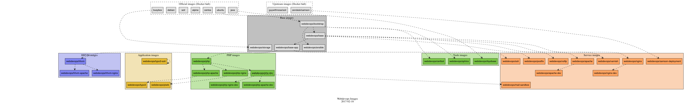

# PHP docker images with super powers 🚀

We provide images which extend the official [PHP-Images](https://hub.docker.com/_/php/tags).
We add additional stuff like:

* almost any PHP module preinstalled
* configuration based on ENV variables
* run multiple services (like php-fpm and nginx) with supervisord

[](https://github.com/webdevops/Dockerfile/issues)[](https://github.com/webdevops/Dockerfile/network)[](https://github.com/webdevops/Dockerfile/stargazers)[](https://github.com/webdevops/Dockerfile/blob/master/LICENSE)
[](https://gitlab.com/webdevops/dockerfile/commits/master)


Automated build and test running on [Gitlab CI](https://gitlab.com/webdevops/dockerfile/) \(GitLab.com CI custom Google Cloud runner\) sponsored by [Onedrop GmbH & Co. KG](https://1drop.de).

[](https://github.com/webdevops/Dockerfile/tree/511a870fa90fe53da5c63a95b4254f6980e6d3d2/documentation/docs/resources/images/docker-image-layout.gv.png)

## Communication and support

Or write an issue in our [GitHub repository](https://github.com/webdevops/Dockerfile/issues).

Or join our discord https://discord.gg/BpBZtXAgJz

## Build process

### File generation

The general build process is currently a mixture of python jinja2 legacy and PHP.

First we build the files inside the `docker` directory using this command:

```
docker run --rm -ti -v $PWD:/app -w /app webdevops/dockerfile-build-env make provision
``` 

It will use the Jinja2 templates inside of the `template` directory and the 
config files from the `provisioning` directory.

**The files in the `docker` directory are never modified manually**

*This will be replaced with PHP twig templates in the future to streamline everything.*

### Building in CI

We generate a multi stage Gitlab-CI configuration using PHP:

```
docker run --rm -ti -v $PWD:/app -w /app/ci webdevops/php:8.4-alpine composer install
docker run --rm -ti -v $PWD:/app -w /app webdevops/php:8.4-alpine ci/console github:generate
```

Gitlab CI builds every image independent and runs serverspec and structure tests on every
image before pushing them to the registry.

### PHP extension builds

PHP images require Docker BuildKit. The official `ghcr.io/php/pie:bin` image
supplies PIE through a build-only mount; the existing INI configuration still
controls extension loading. PIE requests remain unpinned, and compilation uses
`nproc` parallel jobs.

Protobuf, Vips and XML-RPC are built directly from their official upstream sources.
The existing XML-RPC **1.0.0RC3** pin is preserved on all supported PHP versions.
Protobuf on PHP 8.2–8.5 uses the latest upstream release. If a future release raises its minimum PHP
version, older PHP image builds can fail; there is no automatic fallback to an
older release. The existing CI matrix checks compatibility across PHP versions.

The native Vips extension is deprecated and no longer maintained upstream. It is
retained for existing applications, using the upstream default branch (currently
`master`): GitHub tags predate the PECL 1.0.13 release and would downgrade the
extension. This includes changes beyond the last PECL release.
No extension installation needs `pecl.php.net`; Serverspec and container structure
tests retain their existing image matrix.

## Documentation

As in many projects the documentation is kind of up to date 😅.

* [Old version of the documentation is available on readthedocs](https://dockerfile.readthedocs.io/)
* [New version is currently being written on gitbook](https://webdevops.gitbook.io/dockerfile)

### Debian PHP

The following images which are currently supported are based on `php:{VER}-fpm-buster`.

* `webdevops/php:8.2`
* `webdevops/php:8.3`
* `webdevops/php:8.4`
* `webdevops/php:8.5`
* `webdevops/php-dev:8.2`
* `webdevops/php-dev:8.3`
* `webdevops/php-dev:8.4`
* `webdevops/php-dev:8.5`
* `webdevops/php-apache:8.2`
* `webdevops/php-apache:8.3`
* `webdevops/php-apache:8.4`
* `webdevops/php-apache:8.5`
* `webdevops/php-apache-dev:8.2`
* `webdevops/php-apache-dev:8.3`
* `webdevops/php-apache-dev:8.4`
* `webdevops/php-apache-dev:8.5`
* `webdevops/php-nginx:8.2`
* `webdevops/php-nginx:8.3`
* `webdevops/php-nginx:8.4`
* `webdevops/php-nginx:8.5`
* `webdevops/php-nginx-dev:8.2`
* `webdevops/php-nginx-dev:8.3`
* `webdevops/php-nginx-dev:8.4`
* `webdevops/php-nginx-dev:8.5`


### Alpine PHP

The following images which are currently supported are based on `php:{VER}-fpm-alpine`.

* `webdevops/php:8.2-alpine`
* `webdevops/php:8.3-alpine`
* `webdevops/php:8.4-alpine`
* `webdevops/php:8.5-alpine`
* `webdevops/php-dev:8.2-alpine`
* `webdevops/php-dev:8.3-alpine`
* `webdevops/php-dev:8.4-alpine`
* `webdevops/php-dev:8.5-alpine`
* `webdevops/php-apache:8.2-alpine`
* `webdevops/php-apache:8.3-alpine`
* `webdevops/php-apache:8.4-alpine`
* `webdevops/php-apache:8.5-alpine`
* `webdevops/php-apache-dev:8.2-alpine`
* `webdevops/php-apache-dev:8.3-alpine`
* `webdevops/php-apache-dev:8.4-alpine`
* `webdevops/php-apache-dev:8.5-alpine`
* `webdevops/php-nginx:8.2-alpine`
* `webdevops/php-nginx:8.3-alpine`
* `webdevops/php-nginx:8.4-alpine`
* `webdevops/php-nginx:8.5-alpine`
* `webdevops/php-nginx-dev:8.2-alpine`
* `webdevops/php-nginx-dev:8.3-alpine`
* `webdevops/php-nginx-dev:8.4-alpine`
* `webdevops/php-nginx-dev:8.5-alpine`
