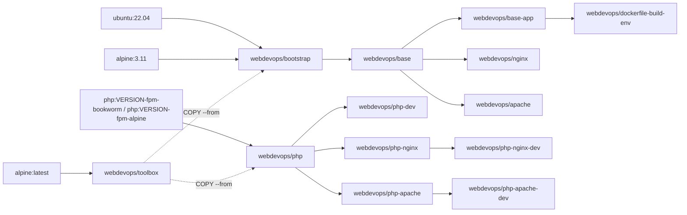

# Documentation

Documentation for the `webdevops/*` Docker images. It describes the images as they are built from this repository.

## Images

| Image | Purpose |
| --- | --- |
| [`webdevops/php`, `webdevops/php-dev`](images/php.md) | PHP-FPM |
| [`webdevops/php-nginx`, `webdevops/php-nginx-dev`](images/php-nginx.md) | PHP-FPM with Nginx |
| [`webdevops/php-apache`, `webdevops/php-apache-dev`](images/php-apache.md) | PHP-FPM with Apache |
| [`webdevops/nginx`](images/nginx.md) | Nginx without PHP |
| [`webdevops/apache`](images/apache.md) | Apache without PHP |
| [`webdevops/bootstrap`, `webdevops/base`, `webdevops/base-app`](images/base.md) | Base images for your own images |
| `webdevops/toolbox` | Build helper, not meant to run. Holds the baselayout scripts (`apt-install`, `apk-install`, `docker-image-cleanup`, `docker-run-bootstrap`, `generate-locales` and more), `go-replace` and `gosu`. `bootstrap` and `php` copy them in with `COPY --from=webdevops/toolbox`. |
| `webdevops/dockerfile-build-env` | Build environment for this repository, based on `base-app:ubuntu-22.04`. It runs `make provision`, see [Build process](../README.md#build-process). |

`webdevops/storage`, `webdevops/vsftp` and `webdevops/ssh` are no longer built, see [Known issues](known-issues.md#migration-from-older-images).

## Platforms and updates

- The images are on Docker Hub for `linux/amd64` and `linux/arm64`. Docker pulls the one that matches your machine.
- The CI rebuilds all tags every night. The build starts at 00:00 UTC and runs without the build cache, so packages and extensions are installed fresh. A tag such as `8.5` therefore points to a new image after every nightly build.
- To keep an image unchanged, pin it by digest. Docker then uses the digest; the tag in front of it is only for readers:

  ```yaml
  services:
    app:
      image: webdevops/php-nginx:8.5@sha256:<digest>
  ```

  `docker buildx imagetools inspect webdevops/php-nginx:8.5` prints the current digest in the line `Digest:`. Update the pinned digest regularly, or you miss security updates.

## Topics

- [Environment variables](environment-variables.md): every setting, with defaults, including [uploads and long requests](environment-variables.md#uploads-and-long-requests)
- [Customization](customization.md): commands, scripts at start and build time, tools for your Dockerfile, services, cron jobs, healthcheck, configuration files, locales, the application user
- PHP images: [Debian or Alpine](images/php.md#debian-or-alpine), [production](images/php.md#production), [installing more extensions](images/php.md#installing-more-extensions), [mail](images/php.md#mail), [Xdebug with an IDE](images/php.md#xdebug-with-an-ide)
- [Known issues](known-issues.md): options that do not work, workarounds, migration from older images

## How the images build on each other


