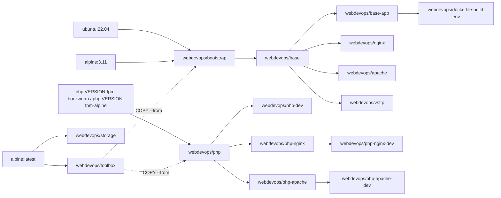

# Documentation

Documentation for the `webdevops/*` Docker images. It describes the images as they are built from this repository.

## Images

| Image | Purpose |
| --- | --- |
| [`webdevops/php`, `webdevops/php-dev`](images/php.md) | PHP-FPM |
| [`webdevops/php-nginx`, `webdevops/php-nginx-dev`](images/php-nginx.md) | PHP-FPM with Nginx |
| [`webdevops/php-apache`, `webdevops/php-apache-dev`](images/php-apache.md) | PHP-FPM with Apache |
| [`webdevops/nginx`](images/nginx.md) | Nginx without PHP |
| [`webdevops/apache`](images/apache.md) | Apache without PHP |
| [`webdevops/bootstrap`, `webdevops/base`, `webdevops/base-app`](images/base.md) | Base images for your own images |
| [`webdevops/vsftp`](images/vsftp.md) | FTP server |
| [`webdevops/storage`](images/storage.md) | Plain Alpine |
| `webdevops/toolbox` | Build helper, not meant to run. Holds the baselayout scripts (`apt-install`, `apk-install`, `docker-image-cleanup`, `docker-run-bootstrap`, `generate-locales` and more), `go-replace` and `gosu`. `bootstrap` and `php` copy them in with `COPY --from=webdevops/toolbox`. |
| `webdevops/dockerfile-build-env` | Build environment for this repository, based on `base-app:ubuntu-22.04`. It runs `make provision`, see [Build process](../README.md#build-process). |

## Topics

- [Environment variables](environment-variables.md): every setting, with defaults
- [Customization](customization.md): commands, scripts at start and build time, tools for your Dockerfile, services, cron jobs, configuration files, locales, the application user
- [Known issues](known-issues.md): options that do not work, workarounds, migration from older images

## How the images build on each other

